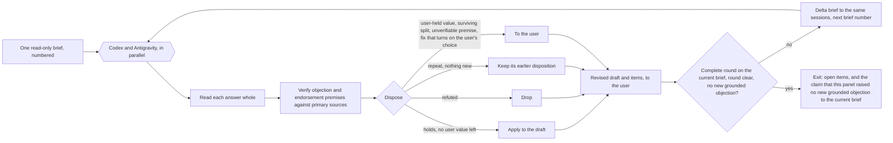

# delphi

`/delphi` is a consult that runs just before a consequential commitment, such as a direction, a design or a policy. Two advisors from other vendors answer the same brief: Codex (through `codex-plus`) and Antigravity (through `agy-plus`). The session that invokes the skill is the facilitator. It checks the facts that the answers lean on. It applies what that check settles. It gives the user the points that only the user can decide. Then it resumes the same two advisor sessions with only what changed, until a round brings no new grounded objection.

The skill is the procedure for one invocation. The user invokes it. A rule about when to invoke it is not part of this plugin.

## Prerequisites

The two seats run through `codex-plus` and `agy-plus`, and the brief follows `stint`'s consult guidance. Install all three from this marketplace.

## Lifecycle



## What the contract fixes

The Lean block in `skills/delphi/SKILL.md` fixes only what holds within one round. The routes an objection takes are the procedure's, written in prose, and the Lean block reads each route as a judgment.

- **An answer.** Briefs are numbered, and a seat has answered when its answer evaluates the current brief and is not blank. An applied change to the draft, a factual repair, a user decision and new context each make a new current brief before the stop is read, so the advisors answer the draft as it now stands before the consult can stop. A round stops the consult only when both seats answered the current brief. A round on an earlier brief never stops it.
- **A clear round.** A round stops the consult only when the facilitator judges it clear: both answers evaluate the brief, verification has been attempted for every premise of the objections and endorsements, and no choice that blocks closing is pending. A premise that could not be verified goes to the user without blocking closing. An empty objection list does not stop a round in which a refuted premise's fix waits on the user's choice. The closing judgments read a seat-free view of the round: its brief, whether both seats answered, and its points.
- **Agreement.** Agreement between the two advisors is provenance and not evidence. The disposition and the keeps-open judgment take an objection's point, so they are independent of the seats an objection lists. They still read the session, from which a judgment could infer who spoke; the procedure says to judge a point on its grounds, and the contract does not prove more than independence from the listed seats.
- **The delta brief.** The brief that a resumed session gets has no field for a seat, a count or a verdict. The user's decisions go in it as constraints. The facts that those decisions lean on stay open to objection.
- **The exit.** The exit hands over the items that are still open, as the procedure carries them. Where such items remain, it also gives each advisor's raw-answer pointer, the answer files and the session id, so that the user can open the raw answers when they need them. The hand-over and the exit do not show the raw answers themselves. The consult claims that this panel raised no new grounded objection to the current brief in this material only when it stopped. When the user ends it earlier, the exit says that the consult ended before a stopping round.

Across rounds, the procedure in the SKILL.md holds the rest, and each item's latest disposition governs. An item routed to the user goes into every later hand-over, into the open points of each delta brief and into the exit, until the user settles it or a later verification refutes it. A point that the user decided goes to the advisors as a decision, not again as an open point.

The guarantees are proved in `lean/Delphi/Theorems.lean`. These proofs are made against a module that is generated from the block in the SKILL.md. To check them, install elan, which reads its toolchain from `lean/lean-toolchain`:

```bash
curl https://raw.githubusercontent.com/leanprover/elan/master/elan-init.sh -sSf | sh   # installs elan (lean + lake)
source "$HOME/.elan/env"   # puts lean and lake on PATH in this shell
delphi/lean/extract.sh   # writes lean/.contract/ from SKILL.md, then lake build --wfail
```

## Where the name comes from

The procedure is closest to the policy line of the Delphi method. It takes one part from each of two sources, and it adds one step of its own:

- **Factual arguments.** Kuusi's *Argument Delphi* is a variant of the Policy Delphi. It gets the factual arguments that are relevant to an issue from a discussion between protagonists and critics ([Kuusi, 1999, §3.10](https://www.doria.fi/bitstream/handle/10024/148479/t59.pdf)).
- **The decision-maker keeps the choice.** Turoff's *Policy Delphi* gives the decision-maker the options and the strongest opposing views. It is not a mechanism that makes the decision. This is cited through Turoff's own chapter in [Linstone & Turoff (eds.), 1975, pp. 80–81](https://www.foresight.pl/assets/downloads/publications/Turoff_Linstone.pdf).
- **Verification.** The facilitator checks the factual premises of each advisor's objections and endorsements against primary sources. This step is the skill's own design.

The procedure keeps three properties of the classical method: separate first answers, iteration and controlled feedback ([Dalkey & Helmer, 1963](https://ideas.repec.org/a/inm/ormnsc/v9y1963i3p458-467.html)). It does not keep the statistical group response or a sized expert panel ([RAND guide](https://www.rand.org/content/dam/rand/pubs/tools/TLA3000/TLA3082-1/RAND_TLA3082-1.pdf)). It keeps anonymity only in part. Remembering one's own answers is compatible with the classical method, which returns each participant's own answers ([RAND guide](https://www.rand.org/content/dam/rand/pubs/tools/TLA3000/TLA3082-1/RAND_TLA3082-1.pdf)). The limit is the two-seat panel: an advisor can often infer that a point it did not make came from the other seat. What the skill can promise is that no point in a brief is attributed to a seat.

The split into independent perspectives has an earlier form in this author's work. Prothesis, an epistemic-protocols protocol first released on 2025-12-26, split perspectives inside one model, ran one subagent per selected perspective, and synthesized their convergence and divergence. It was retired on 2026-09-26 (epistemic-protocols `d1471a9f`). `/delphi` carries that split across vendors. Prothesis's return-time reports of each perspective's horizon limits were rejected at its retirement, because the limits are known when the advisor is chosen, and they are not imported here.

## Why the delta brief has this shape

- **Shared errors.** Models from the same provider make more correlated errors. Models from different providers also share errors. On one benchmark, about 60% of the cases in which both models were wrong had the same wrong answer ([Kim et al., ICML 2025](https://icml.cc/virtual/2025/poster/44225)). This is why a shared premise is checked at its source.
- **Feedback on agreement.** In five human Delphi studies with 628 experts, items reported at 75% agreement or more gained agreement in the next round. Items reported below 75% lost agreement ([feedback study](https://www.sciencedirect.com/science/article/abs/pii/S004016252031310X)). This is why the brief carries no agreement counts.
- **Repetition and speaker labels.** In six open-weight models, a wrong answer that was presented again without a speaker turned 66.5% of the initially correct answers to wrong. A plain re-ask turned 10.3% ([preprint, 2026](https://arxiv.org/abs/2607.05545)). Speaker labels also caused identity bias, which became smaller when the labels were removed ([ACL 2026, Table 1](https://aclanthology.org/2026.acl-long.650.pdf)). This is why the brief carries no attribution and no repeated verdicts.

## Why it stops where it does

- **The stop rule.** Qualitative Delphi ends a study when enough information has been exchanged, or at theoretical saturation ([Skulmoski et al., 2007](https://www.jite.org/documents/Vol6/JITEv6p001-021Skulmoski212.pdf)). Agreement thresholds and stability measures answer different questions ([Dajani et al., 1979](https://www.sciencedirect.com/science/article/abs/pii/0040162579900076); [von der Gracht, 2012](https://www.sciencedirect.com/science/article/pii/S0040162512001023)). For this reason, the consult stops on a complete round that has no new grounded objection.
- **The weakest link.** A quiet round can still miss what the material leaves out. In a synthetic Delphi study, convergence improved under every configuration the study analysed, yet a research area that was missing from the first material was still missing in the later rounds. One of its eight conditions was left out of that analysis because fewer than half of its runs completed validly ([study](https://link.springer.com/article/10.1186/s40309-026-00302-x)). This is why the exit claims no more than its panel and material support.
