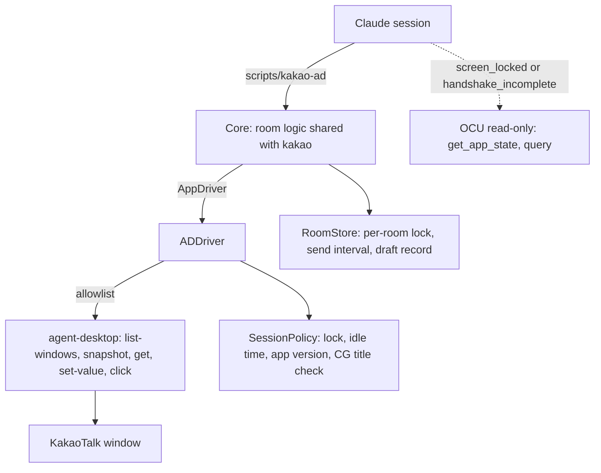

# kakao-ad

kakao-ad runs the [kakao](../kakao) plugin's KakaoTalk room commands — `handshake`, `read`, `draft`, `send`, `clear` — through [agent-desktop](https://github.com/vercel-labs/agent-desktop) instead of kakao's own Swift Accessibility layer. It exists to compare the two call for call, on the same room, with the same rules.

TL;DR: the room logic (binding, markers, send confirmation, exit codes) is the kakao plugin's code, unchanged. Only the layer that touches the window is swapped: kakao calls AX directly; kakao-ad calls a fixed subset of agent-desktop commands. A small Swift helper keeps the checks agent-desktop does not have, and OCU stays where kakao already uses it.

## How the layers split



`helper/Sources/Core` is a byte-for-byte copy of kakao's `Core`; `scripts/check.sh` fails if the two drift apart. kakao implements Core's `AppDriver` with AXUIElement calls; kakao-ad implements it with agent-desktop.

### The agent-desktop subset

The helper refuses any other command or flag before a process starts (`ADClient.swift`, checked by tests and by a source scan in `check.sh`).

| Core needs | agent-desktop command |
| -- | -- |
| the app's windows, their ids and titles | `list-windows --app <name>` |
| the window's element tree | `snapshot --window-id w-<id> --max-depth 40` |
| the input's current text | `get <ref> --property value` |
| whether the send button is enabled | `get <ref> --property states` |
| new rows after a send | `snapshot --root <ref>`, or a fresh window snapshot when the list has no ref |
| put text in the input | `set-value <ref> <text>` |
| press send | `click <ref>` |
| whether Accessibility is granted | `permissions` |

Never used: `press`, `type`, `--headed`, coordinates (`--xy`), `--force`, focus, raise or window commands.

### Who owns each check

| Check | kakao | kakao-ad |
| -- | -- | -- |
| Find the room window, read the tree, set the value, press send | Swift, AXUIElement | agent-desktop subset |
| Screen locked (login window, `CGSSessionScreenIsLocked`) | Swift | Swift (`SessionPolicy`) |
| A person typing in this window (HID idle time) | Swift | Swift (`SessionPolicy`) |
| App version change, frontmost app | Swift | Swift (`SessionPolicy`) |
| CoreGraphics title cross-check (needs Screen Recording) | Swift | Swift (`SessionPolicy`) |
| Per-room lock, minimum send interval, draft record | Swift (`RoomStore`) | the same code |
| Wake the display when locked; look at an unsettled handshake | OCU, read-only | OCU, read-only |

## Where kakao-ad behaves differently

- **Every read starts a process.** Each element read is an agent-desktop call (it keeps a host process warm for 15 minutes), so a command makes many more calls than kakao's in-process AX reads. Expect higher latency; the comparison measures how much.
- **Refs belong to a snapshot.** A command snapshots the window again before it acts; refs from an earlier command are never reused.
- **`textfield` covers two roles.** agent-desktop reports both AXTextArea and AXTextField as `textfield`. kakao-ad maps it to AXTextArea, the role kakao treats as message body and input.
- **Enabled when unknown.** kakao treats an element that does not report AXEnabled as disabled. agent-desktop marks an element `disabled` only when it reports false, so an unknown state reads as enabled.
- **Live value fallback.** When agent-desktop cannot read a value live, `get` answers with the value saved in the snapshot. kakao reads the attribute live or gets nothing.
- **Window titles.** When `list-windows` reports the app's name as a window's title (its fallback when it cannot read the name), kakao-ad takes the window's accessible name from its snapshot. kakao reads AXTitle directly.
- **Separate state.** Room state lives in `~/.local/state/kakao-ad`, so the two plugins never share a send clock or a draft record.
- **Usage text.** `--help` prints kakao's usage text, because the argument parser is the shared Core.

## Install

```bash
xcode-select --install     # swiftc, if not already present
npm i -g agent-desktop     # or point AGENT_DESKTOP_BIN at it
agent-desktop permissions  # Accessibility must be granted to the app that runs Claude Code
```

Then add the marketplace and install `kakao-ad`. `agent-desktop permissions --guide` opens the right settings page.

## Compare with kakao

Open the room's chat window in KakaoTalk, then:

```bash
python3 kakao-ad/scripts/compare.py --room "<exact window title>"              # read, draft, clear only
python3 kakao-ad/scripts/compare.py --room "<your own chat's title>" --self-chat # adds one send per plugin
```

It runs the same sequence on kakao, then on kakao-ad — handshake, read, draft, clear, send (with `--self-chat`), read after the marker — one command at a time, and writes `report.md` and `report.json` with each command's exit code, status, time and evidence (`press_reported`, `input_cleared`, `text_appeared`, `marker_found`, …). Sends happen only with `--self-chat`, which asserts the room is your own chat; both plugins together send at most three messages.

## Offline checks

```bash
kakao-ad/scripts/check.sh
```

Runs kakao's Core tests, the adapter tests against a fake agent-desktop (allowlist, role mapping, and handshake, read and send end to end on the fake), a compile of the helper, the usage-error path, and the source scans. Nothing in it reaches KakaoTalk or runs agent-desktop.

## Not yet verified against the live app

Everything that touches KakaoTalk: whether agent-desktop's snapshot exposes the message rows, input and send button the way kakao's AX walk sees them; whether `set-value` and `click` behave like AXValue and AXPress there; latency; and behaviour while the screen is locked or the window is covered.
