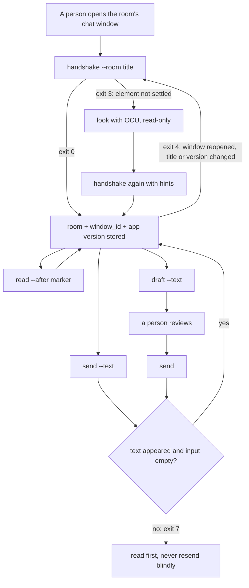

# kakao

Several Claude sessions work several KakaoTalk (macOS) chat rooms at the same time: one session per room window. There is no server, no shared queue and no app-wide lock. A session binds its room once with a **handshake**, then reads, drafts and sends in that window directly.

Every action goes through macOS Accessibility (AX) on that one window: set the input box's value, read it back, press that window's send button. The tool sends no keyboard events, never raises or activates a window, never clicks by coordinates and never closes a window. Key events and raising act on whichever window has focus, so they would break the other rooms.

## Lifecycle



Each command re-checks the window before acting: the stored window id still exists, its title is still the room, the app version is unchanged, and the needed elements are there. Otherwise it stops with exit 4 and the session handshakes again.

## Install

```bash
xcode-select --install   # swiftc, if not already present
```

- Grant **Accessibility** to the terminal app that runs Claude Code (System Settings → Privacy & Security → Accessibility).
- **Screen Recording** for that app is optional. With it, the handshake cross-checks the title against the CoreGraphics window list; without it the check reports `unreadable` and the AX check alone decides.
- The helper builds itself into `~/.cache/kakao/` on first use and rebuilds when its sources change (`KAKAO_CACHE` overrides the directory).

## Commands

All commands print one JSON object with `ok`, `status`, `exit` and `command`.

| Command | What it does |
| -- | -- |
| `handshake --room <title> [hints]` | Finds exactly one KakaoTalk window with that title, its CGWindowID, the input box (value settable), the send button and the message list. Records the KakaoTalk version. |
| `read --room <title> --window <id> [--after <marker>] [--limit <n>]` | Returns message rows (oldest first) and a marker. With `--after`, only newer rows, paged forward from the oldest (`limited: true` means more remain). |
| `draft --room <title> --window <id> --text <text>` | Puts the text into an empty input box and reads it back. |
| `send --room <title> --window <id> [--text <text>] [--accept-edited]` | With text: draft, then press. Without: press for the draft already in the box. Then confirms the text appeared and the box emptied. |
| `clear --room <title> --window <id>` | Empties the input box only when it holds exactly the draft this tool placed. |

Handshake hints, for when the defaults do not find an element: `--send-label <label>` (repeatable; default `전송`, `보내기`, `Send`), `--input-identifier <AXIdentifier>`, `--list-identifier <AXIdentifier>`.

## Exit codes

| Exit | Meaning |
| -- | -- |
| 0 | done |
| 2 | usage error |
| 3 | handshake incomplete — `missing` and `candidates` show what was not settled |
| 4 | handshake again — the window, title, version or an element changed |
| 5 | input busy — text this tool did not place, or a person is typing in that window |
| 6 | not verified — nothing was sent |
| 7 | send unconfirmed — the button was pressed but the result is unknown |
| 8 | draft changed — the box does not hold this tool's draft |
| 9 | unavailable — no permission, app not running, or no toolchain |
| 10 | room not unique — zero or several windows carry the title |

## Safety rules

- **No keyboard, no raising, no coordinates.** If the send button cannot be found, the send fails; it never falls back to Return.
- **Other people's text is left alone.** If the input box holds text this tool did not place, the command stops. Cleanup removes only text that is exactly what this tool put there.
- **A person at the keyboard wins.** If KakaoTalk is frontmost, this window is its focused window, and there was input in the last 2 seconds, the command stops.
- **No blind resend.** After exit 7 the caller reads the room first; the tool never presses twice for one call.
- **Per-room minimum interval.** `send` waits until at least 20 seconds (`KAKAO_MIN_INTERVAL`, `--min-interval`) have passed since the last send in that room, then re-checks the window before pressing.
- **One room, one session.** The tool does not stop two sessions from binding the same room; that is how it is meant to be run.

## State

`~/.local/state/kakao/rooms/<hash>.json` (override with `KAKAO_STATE_DIR`): one small file per room with the window id, app version, hints, the last send time and the draft this tool placed. A `flock` on a sibling lock file serializes sends in the same room. Nothing keeps running between commands.

## Checks

```bash
kakao/scripts/check.sh
```

Runs unit tests against fake windows (the AX layer is not linked), compiles the real helper, runs the CLI paths that exit before touching any app, and scans the sources for keyboard-event, raise, activate, pointer and scripting calls. It does not talk to KakaoTalk.

## Not yet verified against the live app

- Pressing a truncated bubble's full-view button through the window, and whether AX reads omit the cut part.
- Several sessions setting values and pressing buttons in different windows at the same moment.
- Reopening a closed chat window (out of scope; a person reopens it).
- Whether AX reaches a window on another Space or a minimized window.
- The CGWindowID ↔ AX window mapping through the private `_AXUIElementGetWindow` call, and the bounds-based fallback.
- How long one send takes end to end.
- Which elements the default heuristics pick in the current KakaoTalk build: the input box (a text area outside the message table), the send button label, and the message table's row shape.
- The exact title string a chat window reports through AX (a group chat may add a member count or similar). `room_not_unique` lists the titles the app reports.
