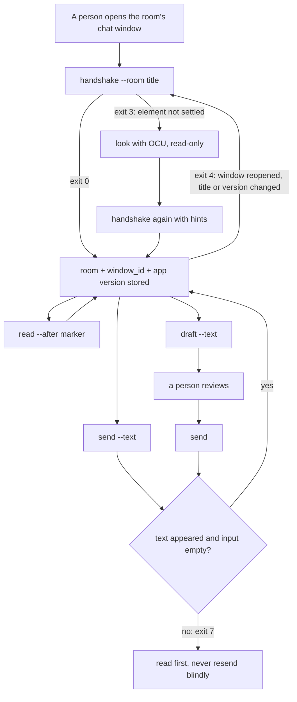

# kakao

Several Claude sessions work several KakaoTalk (macOS) chat rooms at the same time: one session per room window. There is no server, no shared queue and no app-wide lock. A session binds its room once with a **handshake**, then reads, drafts and sends in that window directly.

Every action goes through macOS Accessibility (AX) on that one window: set the input box's value, read it back, press that window's send button. The tool sends no keyboard events, never raises or activates a window, never clicks by coordinates and never closes a window. Key events and raising act on whichever window has focus, so they would break the other rooms.

## Lifecycle



Each command re-checks the window before acting: the stored window id still exists, its title is still the room, the app version is unchanged, and the needed elements are there. Otherwise it stops with exit 4 and the session handshakes again.

## Install

```bash
xcode-select --install   # swiftc, if not already present
```

- Grant **Accessibility** to the terminal app that runs Claude Code (System Settings → Privacy & Security → Accessibility).
- **Screen Recording** for that app is optional. With it, the handshake cross-checks the title against the CoreGraphics window list; without it the check reports `unreadable` and the AX check alone decides.
- The helper builds itself into `~/.cache/kakao/` on first use and rebuilds when its sources change (`KAKAO_CACHE` overrides the directory).

## Commands

All commands print one JSON object with `ok`, `status`, `exit` and `command`.

| Command | What it does |
| -- | -- |
| `handshake --room <title> [hints]` | Finds exactly one KakaoTalk window with that title, its CGWindowID, the input box (value settable), the send button and the message list. Records the KakaoTalk version. |
| `read --room <title> --window <id> [--after <marker>] [--limit <n>]` | Returns message rows (oldest first) and a marker. Each row's `text` is the bubble text; counters, time labels and names go to `labels` and never enter the marker. With `--after`, only newer rows, paged forward from the oldest (`more: "newer"`); without it, the newest `--limit` loaded rows (`more: "older"` when loaded rows were left out). Only rows the window has loaded are seen; the tool never scrolls. |
| `draft --room <title> --window <id> --text <text>` | Puts the text into an empty input box and reads it back. |
| `send --room <title> --window <id> [--text <text>] [--accept-edited]` | With text: draft, then press. Without: press for the draft already in the box. Then confirms the text appeared and the box emptied. |
| `clear --room <title> --window <id>` | Empties the input box only when it holds exactly the draft this tool placed. |

Handshake hints, for when the defaults do not find an element: `--send-label <label>` (repeatable; default `전송`, `보내기`, `Send`), `--input-identifier <AXIdentifier>`, `--list-identifier <AXIdentifier>`.

## Exit codes

| Exit | Meaning |
| -- | -- |
| 0 | done |
| 2 | usage error |
| 3 | handshake incomplete — `missing` and `candidates` show what was not settled |
| 4 | handshake again — the window, title, version or an element changed |
| 5 | input busy — text this tool did not place, or a person is typing in that window |
| 6 | not verified — nothing was sent |
| 7 | send unconfirmed — the button was pressed but the result is unknown |
| 8 | draft changed — the box does not hold this tool's draft |
| 9 | unavailable — no permission, app not running, no toolchain, or the screen is locked (`screen_locked`) |
| 10 | room not unique — zero or several windows carry the title |

## Safety rules

- **No keyboard, no raising, no coordinates.** If the send button cannot be found, the send fails; it never falls back to Return.
- **Other people's text is left alone.** If the input box holds text this tool did not place, the command stops. Cleanup removes only text that matches what this tool put there (line endings unified, outer whitespace ignored); when a draft reads back wrong, the tool removes its own result, or records it so `clear` can.
- **A person at the keyboard wins.** If KakaoTalk is frontmost, this window is its focused window, and there was input in the last 2 seconds — or the idle time cannot be read — the command stops.
- **Sent means seen.** `send` succeeds only when the box emptied and a bubble with the text appeared after the pre-press position. A matching bubble that was already there never counts.
- **No blind resend.** After exit 7 the caller reads the room first; the tool never presses twice for one call.
- **Per-room minimum interval.** `send` waits until at least 20 seconds (`KAKAO_MIN_INTERVAL`, `--min-interval`) have passed since the last send in that room, then re-checks the window before pressing.
- **One room, one session.** The tool does not stop two sessions from binding the same room; that is how it is meant to be run.

## State

`~/.local/state/kakao/rooms/<hash>.json` (override with `KAKAO_STATE_DIR`): one small file per room with the window id, app version, hints, the last send time and the draft this tool placed. A `flock` on a sibling lock file serializes sends in the same room. Nothing keeps running between commands.

## Checks

```bash
kakao/scripts/check.sh
```

Runs unit tests against fake windows (the AX layer is not linked), compiles the real helper, runs the CLI paths that exit before touching any app, and scans the sources for keyboard-event, raise, activate, pointer and scripting calls. It does not talk to KakaoTalk.

## Observed in the live app

Run end to end against a self-chat window and a chat with a bot account (KakaoTalk 26.9.0):

| Step | Result | Time |
| -- | -- | -- |
| `handshake` | exit 0; window id, input box, send button, message list and the CoreGraphics cross-check all `ok`, no hints needed | 6.6 s, including the first build |
| `read --limit 5` | exit 0; time labels landed in `labels`; link-preview cards did not show up as messages | 0.4 s |
| `draft`, then `clear` | exit 0 each | 0.1 s each |
| `send` on an existing draft | exit 0 `sent`; `text_appeared` and `input_cleared` true, `press_reported` false | 0.6 s |
| `send --text` right after | waited out the rest of the 20 s interval before drafting | — |
| 1,562-character text through `--text-file`, then `send` and `read` | exit 0 `sent`; the bubble reads back as its first 500 characters plus `…`, `truncated: true` | 0.6 s |
| `send --text` with the enable wait in place | exit 0 `sent`; `text_appeared` and `input_cleared` true, `press_reported` false | 7.2 s, including a rebuild after the source change (other sends about 0.6 s) |
| `send --text` while the box held 183 characters this tool had not placed | exit 5 `input_busy`; nothing touched | — |
| `send --text` in the bot chat, then `read --after <marker>` 15 s later | exit 0 `sent`; the read returned the sent bubble and the bot's reply as new rows, `marker_found: true` | 8.5 s; `read` there took 3–4 s with 29 loaded rows of long bubbles, against 0.4 s in the self-chat |

What the run showed:

- The send button turns enabled a moment after the box is filled, so `send` waits up to 3 s for it before pressing (before this wait existed, `send --text` ended in exit 6 with the draft cleared; with it, the same command sent).
- The press action can report an AX error although the press happened. `press_reported` records that answer; `text_appeared` and `input_cleared` decide whether the send counts.
- Messages sit in `AXScrollArea > AXTable > AXRow > AXCell`. A bubble's text is a non-settable `AXTextArea`; its time and, on the other party's first bubble, the sender name are separate `AXStaticText` elements, so they land in `labels`.
- The input box is a settable `AXTextArea` in its own scroll area below the table; its description differs by room type, which the role-based search does not depend on. The send button is an `AXButton` titled `전송`.
- Only rows near the screen exist in the AX tree, so `read` covers what is loaded, not the whole history.
- A bubble is cut at 500 visible characters and ends with `…`. Its full-view control is an untitled `AXButton` under the bubble.
- The unread counter is not an element of its own: it is prefixed to the time label (`"1\n오후 10:25"`), so it stays in `labels` and out of the marker. The other party's name is a label too.
- Nothing in the tree marks a bubble as sent by this account or by the other party.
- While the screen is locked, AX reports every KakaoTalk window under the app's name and the window-id call fails for every window; one `read` in that state returned old rows instead of new ones. The helper now stops with exit 9 `screen_locked` in that state, and `read` adds `list_jumped: true` when the rows it returns end earlier than its marker.
- A closed chat window could be reopened from the main window through OCU, with its `sky_click` method (search field, friends tab, double-click on the row); default clicks did nothing in the background. This tool still never opens windows.

## Not yet verified against the live app

- Pressing a cut bubble's full-view control, and what it opens.
- Lock detection through the session dictionary and the frontmost login window, and the time-based `list_jumped` signal (both added after the locked-screen run).
- Where the 3–4 s `read` time in a long chat goes; caching each element's role and not entering text elements should cut AX calls, unmeasured.
- Whether a new bubble shows up in the loaded rows when the window is scrolled up; if not, `send` reports exit 7.
- Several sessions setting values and pressing buttons in different windows at the same moment.
- Whether AX reaches a window on another Space or a minimized window.
- The bounds-based fallback for the window id, for when the private `_AXUIElementGetWindow` call fails (the private call worked in the run above).
- The title string of group chat windows (a member count or similar may be added). `room_not_unique` lists the titles the app reports.
