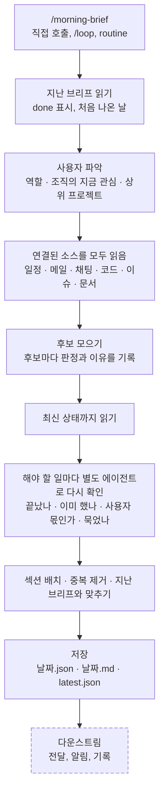

# morning-brief

연결된 업무 도구를 읽고 아침 브리프를 만드는 플러그인입니다. 브리프에는 오늘 해야 할 일, 놓쳤을 소식, 밀어 줄 일 하나, 오늘 일정이 들어갑니다. 브리프는 사용자 언어로 쓰고, 날짜별 JSON과 markdown 파일로 저장합니다. 다른 자동화는 이 JSON을 그대로 읽어 쓰면 됩니다.

해야 할 일은 하나씩 원본을 최신 상태까지 읽어 확인합니다. 그다음 문맥이 없는 별도 에이전트가 이미 끝났는지, 사용자 몫인지 다시 따져 봅니다. 확인을 통과한 항목만 브리프에 들어갑니다.

## 흐름



점선 상자는 이 플러그인 밖의 일입니다. 실행하는 동안에는 읽기만 합니다. 메시지를 보내거나 답하거나 수정하는 일은 하지 않고, 쓰는 것은 저장 파일뿐입니다.

## 설치와 설정

```bash
/plugin install morning-brief@cc-plugin
```

| 옵션 | 뜻 | 비워 두면 |
| --- | --- | --- |
| `output_dir` | 브리프를 저장할 절대 경로 | 플러그인 데이터 디렉터리 (`~/.claude/plugins/data/<id>/`) |
| `language` | 브리프 언어 (`ko`, `en` 등) | 세션이 답하는 언어 |

스킬은 Opus에서 effort medium으로 돕니다. SKILL.md의 `model`과 `effort` frontmatter가 이를 정합니다. 확인 단계에서 서브에이전트를 띄워야 하므로, 스킬은 fork하지 않고 호출한 세션 안에서 돕니다.

## 호출

```text
/morning-brief               오늘 브리프를 만들고 저장
/morning-brief 2026-11-20    그 날짜로 만듦
/morning-brief --no-save     저장하지 않고 보여 주기만 함
```

## 다운스트림이 읽는 법

- `latest.json`은 실행이 끝날 때마다 다시 씁니다. 다운스트림은 이 파일 하나만 보면 됩니다.
- 날짜별 파일 `<YYYY-MM-DD>.json`은 기록용으로 남습니다. 같은 날 다시 실행하면 그날 파일을 덮어씁니다.
- 스키마는 `skills/morning-brief/references/output.md`에 있습니다. 키와 enum 값은 영어로 고정하고, 사람이 읽는 값만 브리프 언어로 씁니다.
- `top_todos[].done`을 `true`로 바꾸면 다음 브리프는 그 항목을 다시 올리지 않습니다. 새 활동으로 다시 열린 경우는 예외입니다. 다운스트림이나 사용자가 바꾸면 됩니다.
- `id`는 원본 URL에서 query와 fragment를 뺀 값입니다. 같은 항목을 날짜를 넘어 추적할 때 씁니다.

매일 같은 시각에 돌리려면 schedule(routine)이나 `/loop`로 `/morning-brief`를 부릅니다. Slack이나 Notion으로 보내는 일은 그 뒤에 `latest.json`을 읽는 별도 단계가 맡습니다.
