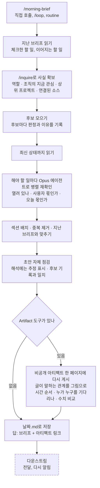

# morning-brief

연결된 업무 도구를 읽고 아침 브리프를 만드는 플러그인입니다. 브리프에는 오늘 해야 할 일, 놓쳤을 소식, 밀어 줄 일, 오늘 일정이 들어갑니다. 확인을 통과한 항목은 개수를 정해 두지 않고 모두 보여 줍니다. 브리프는 첫 행동을 고르기 전에 알아야 할 것을 한 줄씩 적으며 시작합니다. 각 항목은 다음 행동이나 달라진 점으로 시작하고, 그 한 줄로 판단할 수 있으면 거기서 끝냅니다. 더 필요한 항목은 독자의 다음 선택이 더는 달라지지 않는 데까지만 씁니다. 제목, 날짜, 항목까지 모두 사용자 언어로 씁니다.

해야 할 일은 하나씩 원본을 최신 상태까지 읽어 확인합니다. 그다음 문맥이 없는 별도 에이전트가 세 가지를 다시 따져 봅니다. 아직 열려 있는지, 사용자 몫인지, 오늘 해야 하는지입니다. 세 가지를 모두 통과한 항목만 오늘 할 일에 들어갑니다. 사용자에게 온 요청이나 사용자가 한 약속 가운데 아직 열려 있지만 오늘 몫이 아닌 것은 따로 한 줄씩 보여 줍니다. 그 줄에는 기한이 없다, 기다리는 사람이 없다 같이 오늘 몫이 아닌 이유를 사실로 적습니다. 오늘 몫인지는 지금 누군가 기다리는 대가를 치르고 있는지, 또는 오늘 잃는 것이 있는지로 가립니다. 사용자가 남에게 약속한 날짜는 지켜지거나 다시 정해질 때까지 매일 오늘 몫입니다. 사용자가 자기 자신에게만 정한 날짜는 지났다는 것만으로 오늘 몫이 되지 않습니다.

브리프의 순서는 먼저 시작할 일, 오늘 할 일, 밀어 줄 일, 열려 있지만 오늘은 아닌 것, 소식, 오늘 일정, 앞으로의 일정, 맺음입니다. 같은 항목을 여러 곳에서 말할 때는 같은 행동, 같은 결정 주체, 같은 확실성으로 적습니다.

브리프는 출처가 말한 것과 Claude의 해석을 구분합니다. 해석은 오늘의 행동을 바꿀 때만 쓰고, '추정'이라고 표시해 근거가 된 사실과 출처 링크 옆에 둡니다. 추정한 담당자, 기한, 약속은 사실처럼 쓰지 않고, 그것만으로 할 일을 만들지도 않습니다.

## 흐름



점선 상자는 이 플러그인 밖의 일입니다. 실행하는 동안 연결된 도구는 읽기만 합니다. 메시지를 보내거나 답하거나 수정하는 일은 하지 않습니다. 쓰는 것은 그날 브리프 파일, 비공개 아티팩트 페이지, 그 주소를 적은 파일뿐입니다.

수집과 확인에 시간이 더 걸려도 확인을 줄이지 않습니다. 해야 할 일마다 Opus 서브에이전트가 병렬로 확인하고, 수집을 맡는 서브에이전트도 Opus에서 돕니다.

## 그림으로 보는 브리프

세션에 Artifact 도구가 있으면, 브리프를 비공개 아티팩트 한 페이지로도 올립니다. 글로 따라가야 하는 관계를 한눈에 보게 해서 읽는 부담을 줄이려는 것입니다. 예를 들면 회의와 할 일 마감을 한 시간축에 놓은 그림, 누가 누구를 어떤 일로 기다리는지 보여 주는 그림, 출처가 잰 수치를 한 눈금 위에서 길이로 비교하는 그림입니다. 글이 말하는 관계 가운데 글의 배치만으로는 드러나지 않는 것만 그리고, 꾸밈용 그림은 넣지 않습니다. 페이지의 글은 자체 점검을 거친 markdown 브리프에서 가져옵니다. 아티팩트는 하나를 계속 쓰고, 그 주소는 `<dir>/artifact-url`에 둡니다. Artifact 도구가 없으면 이 단계를 건너뛰고, 기록은 어느 쪽이든 날짜별 markdown입니다.

## 의존

1단계에서 사실을 확보할 때 epistemic-protocols의 `aitesis` 플러그인(`/inquire`)을 부릅니다. 설치해 두기를 권합니다. `/inquire`나 서브에이전트 도구, Artifact 도구, 커넥터가 없으면 스킬은 가진 수단으로 그 단계의 결과를 내고, 무엇 없이 돌았는지를 브리프 맺음 줄에 적습니다.

```bash
/plugin marketplace add jongwony/epistemic-protocols
/plugin install aitesis@epistemic-protocols
```

## 설치와 설정

```bash
/plugin install morning-brief@cc-plugin
```

| 옵션 | 뜻 | 비워 두면 |
| --- | --- | --- |
| `output_dir` | 그날 브리프를 저장할 절대 경로 | 플러그인 데이터 디렉터리 (`~/.claude/plugins/data/<id>/`) |
| `language` | 브리프 언어 (`ko`, `en` 등) | 세션이 답하는 언어 |

스킬은 Opus에서 effort medium으로 돕니다. SKILL.md의 `model`과 `effort` frontmatter가 이를 정합니다. 확인 단계에서 서브에이전트를 띄워야 하므로, 스킬은 fork하지 않고 호출한 세션 안에서 돕니다.

## 호출

```text
/morning-brief               오늘 브리프를 만들고 저장
/morning-brief --no-save     저장하지 않고 보여 주기만 함
```

브리프는 항상 오늘 것입니다. 페이지가 없을 때는 답에 저장한 브리프의 위치를 적습니다. `--no-save`는 답만 하고 파일, 페이지, 페이지 주소를 그대로 둡니다.

## 저장 파일과 다운스트림

- 실행할 때마다 `<YYYY-MM-DD>.md` 하나를 저장합니다. 다음 실행은 이 파일을 읽고, 이미 다룬 소식은 다시 올리지 않습니다. 남은 할 일은 언제부터 열려 있었는지와 함께 이어서 올립니다.
- 할 일은 체크리스트로 적습니다. 체크와 메모는 사용자가 알려 준 것으로 받습니다. 원본 기록이 말하는 것이 있으면 기록을 따릅니다. 기록이 말하지 않으면 사용자 자신의 몫에 대해서는 사용자의 말을 따르고, 다른 사람의 행동에 대한 말은 그 사람의 기록이 보여 줄 때까지 사용자의 말로 적어 둡니다.
- 저장 파일에서 사용자가 쓴 말은 그대로, Claude가 쓴 글과 구분되게 둡니다. 체크박스는 모두 빈 칸으로 쓰고, 옮겨 온 메모는 인용하고 사용자의 말이라고 표시합니다.
- 지난 브리프와 상태가 달라진 항목은 무엇 때문에 달라졌는지를 그 항목이 지금 있는 자리에 적습니다. 자리가 없으면 맺음에 적습니다. 기록으로 확인된 체크는 따로 적지 않습니다.
- 브리프는 하루 한 번 만들고 다시 알리지 않습니다. 언제 다시 알릴지와 어디로 보낼지는 다운스트림이 정합니다.
- 전달은 다운스트림이 맡습니다. Slack이나 Notion으로 보내기 등이 여기에 들어갑니다. 매일 돌리는 방법은 아래 「영업일마다 돌리기」에 있습니다. 그 뒤 단계는 답이나 저장 파일을 받아 처리합니다.

## 영업일마다 돌리기

같은 플러그인의 `morning-brief:daily` 스킬이 맡습니다. 늘 켜 두는 세션(예: aiward)에서 영업일 아침 시각을 정해 반복 작업을 만들고, 그 프롬프트는 아래 한 줄입니다.

```text
Invoke the morning-brief:daily skill through the Skill tool and follow it.
```

- 실행할 때마다 먼저 반복 작업을 같은 프롬프트로 다시 만들고 실행된 작업을 지웁니다. 반복 작업은 만든 지 7일이 지나면 사라지는데, 이렇게 갱신하면 쉬는 날이 이어져도 사라지지 않습니다.
- 캘린더에서 공휴일, 팀 휴가 캘린더의 사용자 휴가, 사용자 캘린더의 부재 일정을 읽습니다. 쉬는 날이거나 오늘 브리프가 이미 저장돼 있으면 아무것도 하지 않습니다.
- 일하는 날에는 브리프를 만드는 백그라운드 세션 `brief::<YYYY-MM-DD>`를 Remote Control을 켜서 띄웁니다. 브리프가 저장되면 "브리프 준비됨" 푸시를 보내고, 푸시를 누르면 그 세션이 열려 오늘 할 일을 이어서 이야기할 수 있습니다.
- 반복 작업은 그것을 만든 세션 안에만 있습니다. 그 세션이 다시 시작되면 작업이 있는지 보고, 없으면 다시 만듭니다.
- 절차를 바꾸는 일은 이 스킬을 고치는 커밋입니다. 반복 작업의 프롬프트는 바뀌지 않습니다.
