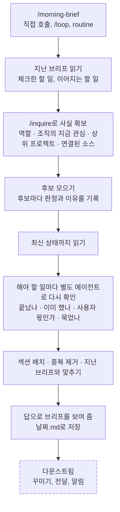

# morning-brief

연결된 업무 도구를 읽고 아침 브리프를 만드는 플러그인입니다. 브리프에는 오늘 해야 할 일, 놓쳤을 소식, 밀어 줄 일, 오늘 일정이 들어갑니다. 확인을 통과한 항목은 개수를 정해 두지 않고 모두 보여 줍니다. 간단한 항목은 짧게, 중요하거나 얽힌 항목은 필요한 만큼 길게 설명합니다. 제목, 날짜, 항목까지 모두 사용자 언어로 씁니다.

해야 할 일은 하나씩 원본을 최신 상태까지 읽어 확인합니다. 그다음 문맥이 없는 별도 에이전트가 이미 끝났는지, 사용자 몫인지 다시 따져 봅니다. 확인을 통과한 항목만 브리프에 들어갑니다.

## 흐름



점선 상자는 이 플러그인 밖의 일입니다. 실행하는 동안에는 읽기만 합니다. 메시지를 보내거나 답하거나 수정하는 일은 하지 않고, 쓰는 것은 그날 브리프 파일 하나뿐입니다.

## 의존

1단계에서 사실을 확보할 때 epistemic-protocols의 `aitesis` 플러그인(`/inquire`)을 부릅니다. 먼저 설치해 두어야 합니다.

```bash
/plugin marketplace add jongwony/epistemic-protocols
/plugin install aitesis@epistemic-protocols
```

## 설치와 설정

```bash
/plugin install morning-brief@cc-plugin
```

| 옵션 | 뜻 | 비워 두면 |
| --- | --- | --- |
| `output_dir` | 그날 브리프를 저장할 절대 경로 | 플러그인 데이터 디렉터리 (`~/.claude/plugins/data/<id>/`) |
| `language` | 브리프 언어 (`ko`, `en` 등) | 세션이 답하는 언어 |

스킬은 Opus에서 effort medium으로 돕니다. SKILL.md의 `model`과 `effort` frontmatter가 이를 정합니다. 확인 단계에서 서브에이전트를 띄워야 하므로, 스킬은 fork하지 않고 호출한 세션 안에서 돕니다.

## 호출

```text
/morning-brief               오늘 브리프를 만들고 저장
/morning-brief 2026-11-20    그 날짜로 만듦
/morning-brief --no-save     저장하지 않고 보여 주기만 함
```

## 저장 파일과 다운스트림

- 실행할 때마다 `<YYYY-MM-DD>.md` 하나를 저장합니다. 다음 실행은 이 파일을 읽고, 이미 다룬 소식은 다시 올리지 않습니다. 남은 할 일은 언제부터 열려 있었는지와 함께 이어서 올립니다.
- 할 일은 체크리스트로 적습니다. 체크한 항목은 끝난 것으로 보고, 새 활동으로 다시 열리지 않는 한 다음 브리프에 올리지 않습니다.
- 브리프는 하루 한 번 만들고 다시 알리지 않습니다. 언제 다시 알릴지와 어디로 보낼지는 다운스트림이 정합니다.
- 꾸미기와 전달은 다운스트림이 맡습니다. HTML로 보여 주기, Slack이나 Notion으로 보내기 등이 여기에 들어갑니다. 매일 같은 시각에 돌리려면 schedule(routine)이나 `/loop`로 `/morning-brief`를 부르고, 그 뒤 단계가 답이나 저장 파일을 받아 처리합니다.
