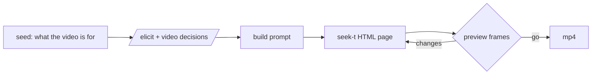

# motion-elicit

For someone who wants a short motion-graphics video but can't yet say what it should be, and who may know nothing about motion design or prompting. `/motion-elicit` asks about the decisions such a video turns on, in plain words. It builds the video as a web page drawn from code, shows preview frames, and renders an mp4 once they're approved.



## Install

```bash
/plugin install euporia@epistemic-protocols   # provides /elicit
/plugin install motion-elicit@cc-plugin
npm i -g playwright && npx playwright install chromium
brew install ffmpeg                             # or: apt install ffmpeg
```

## Pieces

| Piece | Role |
|---|---|
| `skills/motion-elicit/SKILL.md` | Decisions every video turns on (the slow axes), plus the build → preview → render procedure |
| `skills/motion-elicit/references/fast-axes.md` | Decisions that depend on the kind of video (motion, 3d, explainer, interactive), and how to pull live examples |
| `skills/motion-elicit/scripts/corpus.py` | Reads [awesome-opus5-5-videos](https://github.com/yihui-dev/awesome-opus5-5-videos) `data/videos.json` live: `examples` lists links to look at, `axes` re-measures which decisions vary by kind |
| `skills/motion-elicit/scripts/render.cjs` | Steps a `window.seek(t)` page through time with Playwright and encodes it with ffmpeg; `--preview` writes PNGs instead |

## Slow and fast

Slow decisions hold for every kind of video, so they live in `SKILL.md`. Fast decisions vary by kind, so they live in `references/`. The split is measured, not fixed: `python3 -I skills/motion-elicit/scripts/corpus.py axes` prints each decision's spread across kinds. If a slow decision's spread grows, or a fast one's shrinks, move it to the other file.

## Test

```bash
python3 -I skills/motion-elicit/scripts/corpus.py examples --category motion --limit 3
node skills/motion-elicit/scripts/render.cjs page.html --size 320x320 --preview 0,1
node skills/motion-elicit/scripts/render.cjs page.html --size 320x320
```
