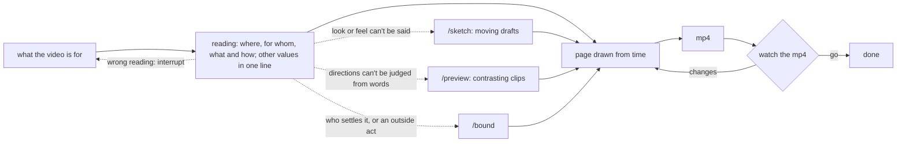

# motion

For someone who wants a short motion-graphics video but can't yet say what it should be, and who may know nothing about motion design or prompting. `/motion` shows, in plain words, how it read the request — where and for whom the video is used, what it shows and how — names the values it takes for everything else, and starts building at once; a wrong reading is stopped with an interrupt. Where words run out, it lets the person see drafts or contrasting directions instead. It builds the video as a web page drawn from code, renders it as an mp4, and shows them that mp4 to approve or change.



The dotted paths are taken only where the run shows that need. The build does not wait on the reading; the person's checkpoint is the mp4.

## Composition

| Protocol | Enters when |
|---|---|
| `/sketch` | The look or the movement would be recognized on sight but cannot be described |
| `/preview` | The person must commit to one of several directions they cannot judge from descriptions |
| `/bound` | Who settles an open decision, or how far an install, download, or licensed asset may go, is unsettled |

## Pieces

| Piece | Role |
|---|---|
| `skills/motion/SKILL.md` | How the request is read, decisions every video turns on, where the other protocols enter, and page → mp4 → watch |
| `skills/motion/references/fast-axes.md` | Decisions that change with the kind of video, and real examples to point at |

## Install

```bash
claude plugin marketplace add jongwony/cc-plugin
claude plugin install motion@cc-plugin
```

Then install the protocol plugins `skills/motion/SKILL.md` lists under Prerequisites.
