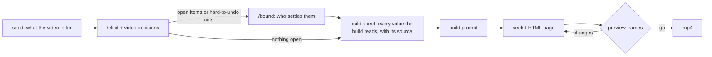

# motion

For someone who wants a short motion-graphics video but can't yet say what it should be, and who may know nothing about motion design or prompting. `/motion` asks about the decisions such a video turns on, in plain words. It builds the video as a web page drawn from code, shows preview frames, and renders an mp4 once they're approved.



## Install

```bash
/plugin install motion@cc-plugin
```

Then install what `skills/motion/SKILL.md` lists under Prerequisites.

## Pieces

| Piece | Role |
|---|---|
| `skills/motion/SKILL.md` | Decisions every video turns on (the slow axes), plus the build → preview → render procedure |
| `skills/motion/references/fast-axes.md` | Decisions that depend on the kind of video, and how to pull live examples |
| `skills/motion/references/rendering.md` | How the builder turns the `seek(t)` page into preview frames and the mp4 with Playwright and ffmpeg, and the mistakes that go wrong without failing |
| `skills/motion/references/axes.json` | The pattern each decision is measured by, keyed by the decision's name in `SKILL.md` or `fast-axes.md` |
| `skills/motion/scripts/corpus.py` | Reads [awesome-opus5-5-videos](https://github.com/yihui-dev/awesome-opus5-5-videos) `data/videos.json` live: `examples` lists links to look at, `axes` re-measures which decisions vary by kind |

## Slow and fast

Slow decisions hold for every kind of video, so they live in `SKILL.md`. Fast decisions vary by kind, so they live in `references/`. `python3 -I skills/motion/scripts/corpus.py axes` prints each decision's spread across kinds, which informs revisiting the split; moving a decision is a judgment, not a threshold.

## Test

```bash
python3 -I skills/motion/scripts/corpus.py examples --limit 3
python3 -I skills/motion/scripts/corpus.py axes
```

There is no renderer to test: the builder writes the capture for each run from `references/rendering.md`, and the person checks the result at the preview.
