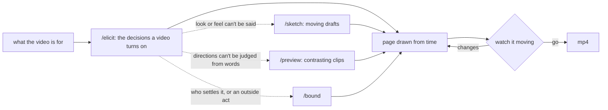

# motion

For someone who wants a short motion-graphics video but can't yet say what it should be, and who may know nothing about motion design or prompting. `/motion` asks about the decisions such a video turns on, in plain words. Where words run out, it lets the person see drafts or contrasting directions instead. It then builds the video as a web page drawn from code, shows it moving, and renders an mp4 once they approve it.



The dotted paths are taken only where the run shows that need.

## Composition

| Protocol | Enters when |
|---|---|
| `/elicit` | Always: what the video should be is not yet said |
| `/sketch` | The look or the movement would be recognized on sight but cannot be described |
| `/preview` | The person must commit to one of several directions they cannot judge from descriptions |
| `/bound` | Who settles an open decision, or how far an install, download, or licensed asset may go, is unsettled |

## Pieces

| Piece | Role |
|---|---|
| `skills/motion/SKILL.md` | Decisions every video turns on, where the other protocols enter, and page → watch → mp4 |
| `skills/motion/references/fast-axes.md` | Decisions that change with the kind of video, and real examples to point at |

## Install

```bash
/plugin install motion@cc-plugin
```

Then install the protocol plugins `skills/motion/SKILL.md` lists under Prerequisites.
