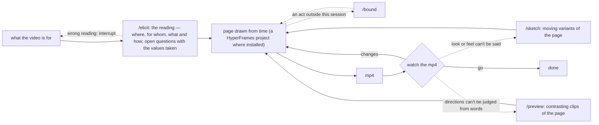

# motion

For someone who wants a motion-graphics video made from code. `/motion` reads back through `/elicit`, at the level the person's own words show, how it took the request — where and for whom the video is used, what it shows and how — puts what the reading leaves open as questions carrying the values it takes, and starts building at once; a wrong reading is stopped with an interrupt. The video is made to the craft its use calls for, as a HyperFrames project where HyperFrames is installed and otherwise as a web page drawn from code; it is rendered as an mp4 and shown to approve or change; where a change cannot be settled in words, the person sees variants or contrasting directions of the video instead.



The dotted paths are taken only where the run shows that need. The build does not wait for the `/elicit` run to close: it stays open beside the build, and the person's checkpoint is the mp4 — where a change cannot be settled in words, `/sketch` or `/preview` start from it.

## Composition

| Protocol | Enters when |
|---|---|
| `/elicit` | Always: it opens the run with the reading of the request, and the build does not wait for it to close |
| `/sketch` | After an mp4: the look or the movement would be recognized on sight but cannot be described |
| `/preview` | After an mp4: the person must commit to one of several directions they cannot judge from descriptions |
| `/bound` | Before an act of the build that reaches outside this session: an install, a download, a licensed asset |

## Pieces

| Piece | Role |
|---|---|
| `skills/motion/SKILL.md` | How the request is read, decisions every video turns on, where the other protocols enter, and page → mp4 → watch |
| `skills/motion/references/fast-axes.md` | Decisions that change with the kind of video, and real examples to point at |

## Install

```bash
claude plugin marketplace add jongwony/cc-plugin
claude plugin install motion@cc-plugin
```

Then install the protocol plugins `skills/motion/SKILL.md` lists under Prerequisites. HyperFrames is optional: with it installed, the video is built and rendered as a HyperFrames project.
