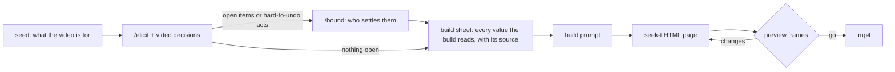

# motion

For someone who wants a short motion-graphics video but can't yet say what it should be, and who may know nothing about motion design or prompting. `/motion` asks about the decisions such a video turns on, in plain words. It builds the video as a web page drawn from code, shows preview frames, and renders an mp4 once they're approved.



## Install

```bash
/plugin install euporia@epistemic-protocols   # provides /elicit
/plugin install horismos@epistemic-protocols  # provides /bound, used only when something is left open or the render would do something hard to undo
/plugin install motion@cc-plugin
brew install python node ffmpeg                # or: apt install python3 ffmpeg, plus Node 18+ from nodejs.org or nvm
npm i -g playwright && npx playwright install chromium   # on Linux: npx playwright install --with-deps chromium
```

## Pieces

| Piece | Role |
|---|---|
| `skills/motion/SKILL.md` | Decisions every video turns on (the slow axes), plus the build → preview → render procedure |
| `skills/motion/references/fast-axes.md` | Decisions that depend on the kind of video, and how to pull live examples |
| `skills/motion/references/axes.json` | The pattern each decision is measured by, keyed by the decision's name in `SKILL.md` or `fast-axes.md` |
| `skills/motion/scripts/corpus.py` | Reads [awesome-opus5-5-videos](https://github.com/yihui-dev/awesome-opus5-5-videos) `data/videos.json` live: `examples` lists links to look at, `axes` re-measures which decisions vary by kind |
| `skills/motion/scripts/render.cjs` | Serves the page's folder on a loopback port, steps its `window.seek(t)` through time with Playwright, and encodes it with ffmpeg; `--preview` writes PNGs instead, `--range a,b` a short clip, `--check` is the skill's preflight |

## Slow and fast

Slow decisions hold for every kind of video, so they live in `SKILL.md`. Fast decisions vary by kind, so they live in `references/`. `python3 -I skills/motion/scripts/corpus.py axes` prints each decision's spread across kinds, which informs revisiting the split; moving a decision is a judgment, not a threshold.

## Test

```bash
node skills/motion/scripts/render.cjs --check
python3 -I skills/motion/scripts/corpus.py examples --category motion --limit 3
node skills/motion/scripts/render.cjs page.html --size 320x320 --preview 0,1
node skills/motion/scripts/render.cjs page.html --size 320x320 --fps 30
```
