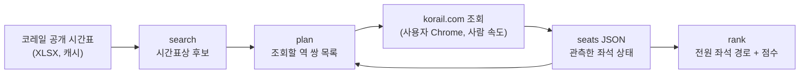

# rail-route

주말처럼 직통 열차가 매진일 때, 일행 모두가 앉아서 갈 수 있는 기차 경로를 찾습니다. 갈아타기, 같은 열차를 구간으로 나눠 사기(구간분할), 다른 출발·도착역까지 함께 봅니다.

## 동작 방식

- **search**: 코레일이 게시판에 올린 계획 시간표만으로 경로 후보를 만듭니다. 같은 역에서 환승하고 15분 이상 여유를 둡니다. 설정한 역끼리는 이동 시간을 더해 환승할 수 있습니다.
- **plan**: 후보의 좌석을 확정하려면 korail.com에서 어떤 역 쌍을 조회해야 하는지, 가장 유망한 순서로 알려 줍니다. 전 구간이 매진이면 같은 열차의 구간분할 조회를 다음으로 제안합니다.
- **rank**: 관측한 좌석 상태로 인원 전원이 앉을 수 있는 경로만 남기고 점수로 줄 세웁니다. 점수는 집 도착 시각(분)에 환승 횟수, 대기 시간, 매진임박 구간 수, ITX·무궁화 탑승 시간을 가중치로 더한 값입니다.
- `--ktx-main-min`을 주면 KTX급 열차 탑승 시간이 그보다 짧은 경로는 뺍니다.

## 설정

집과 역 사이 이동 시간, 역 간 환승 이동 시간, 점수 가중치는 저장소 밖의 `~/.config/rail-route/config.json`(또는 `.toml`)에 둡니다. 주소는 적지 않고 역별 분만 적습니다.

## 지키는 선

- 좌석 상태는 사용자 Chrome에 뜬 korail.com 화면에서만 읽습니다. 코레일 앱 API나 토큰 생성은 쓰지 않습니다.
- 자동 새로고침·취소표 감시는 하지 않습니다. 차단(-4001)이나 CAPTCHA가 뜨면 그 자리에서 멈춥니다.
- 장바구니는 사용자가 직접 로그인한 뒤에, 결제는 언제나 사용자가 합니다.

## 준비

`uv`가 필요합니다(`brew install uv`). 테스트: `uv run --with openpyxl python -m unittest discover -s rail-route/tests`
