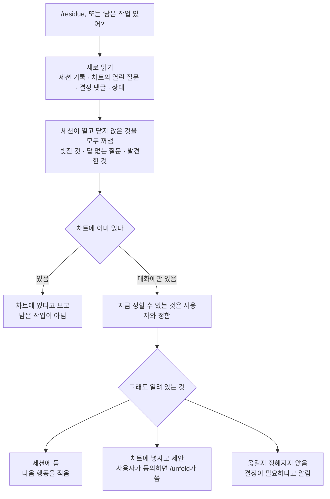

# residue

세션이 아직 들고 있는 열린 것을, 물었을 때 꺼내 주는 플러그인입니다. 세션은 일하는 동안 하겠다고 한 일, 답이 없는 질문, 도중에 발견한 것을 대화 안에 쌓습니다. 이것들은 대화가 compaction되거나 끝나면 함께 사라집니다. `/residue`는 그 목록을 세션 기록과 차트를 새로 읽어서 만들고, 어디로 갈지를 가릅니다.

매 답변 끝에 상태를 적는 방식을 대신합니다. 필요할 때 호출합니다.

## 흐름



읽기 쉬운 순서로 보면 다음과 같습니다.

1. 세션 기록과 차트를 그 자리에서 다시 읽습니다. 기억으로 답하지 않습니다.
2. 이 세션이 열고 닫지 않은 것을 거르지 않고 세 종류로 꺼냅니다. 세션이 끝냈다고 한 일은 `/contextualize`로 요청한 것과 놓인 자리에 맞는지 확인하고, 맞지 않는 곳은 빚진 것으로 남깁니다.
3. 항목마다 차트에 이미 있는지 표시합니다. 차트에 있는 것은 남은 작업이 아닙니다. 다만 세션이 맡은 일은 차트에 적었다고 끝나지 않습니다.
4. 지금 정할 수 있는 것은 사용자와 정합니다.
5. 나머지를 세 갈래로 가릅니다: 세션에 둔다, 차트에 넣자고 제안한다, 결정이 필요하다고 알린다.
6. 한 번 보고합니다. 열린 것이 없으면 무엇을 읽었는지와 함께 한 줄로 말합니다.

## 쓰지 않는 것

- Linear에는 직접 쓰지 않습니다. 차트로 옮기는 일은 사용자가 동의한 뒤 [`unfold`](../unfold)의 `decide`와 `group`이 합니다.
- 닫힌 차트에는 쓰자고 제안하지 않습니다. 닫혔다고 말하고 어디로 보낼지는 사용자에게 둡니다.
- 차트 자체의 열린 질문을 이 세션의 것으로 세지 않습니다.

## 설치

```
/plugin install residue --marketplace jongwony/cc-plugin
```

끝낸 일을 확인하는 단계는 epistemic-protocols의 `epharmoge` 플러그인(`/contextualize`)을 부릅니다. 먼저 설치해 두어야 합니다.

차트에 쓰는 단계를 쓰려면 `unfold` 플러그인과 Linear MCP가 필요합니다. 없으면 제안까지만 합니다.

## 함께 읽는 것

- 원칙은 `rules/remaining-work.md`에 있습니다: 무엇이 남은 작업인가, 세션과 Linear의 두 계층.
